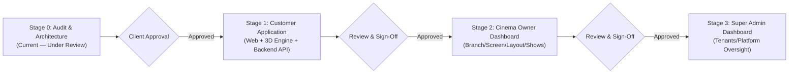

# Implementation Roadmap — 3D Cinema Booking SaaS Platform

**Project:** Multi-Tenant Cinema Management & 3D Ticket Booking SaaS Platform  
**Document Version:** 1.0  
**Current Stage:** Stage 0 (Audit & Architecture Sign-Off)  
**Primary Focus:** Stage 1 — Customer Application  
**Reference Document:** `docs/PHASE_0_SPECIFICATION.md`

---

## 1. Overall Project Phasing & Progression Gates

> [!IMPORTANT]
> **Strict Progression Rule:** No work on Stage 2 (Owner Dashboard) or Stage 3 (Super Admin Dashboard) will begin until Stage 1 (Customer Application) is fully built, integrated with Stitch designs, verified with real tests, and approved by the client.

---

## 2. Stage 1 — Customer Application Breakdown

The Customer Application delivers the complete consumer journey across desktop and mobile browsers, anchored by the interactive 3D theatre experience.

### 2.1 Customer Journey Pages & Features (Per Phase 0.3 Specification)
1. **Home / Cinema Landing Page:**
   - Featured now-showing movies marquee / carousel.
   - Quick cinema branch & city selector.
   - Upcoming releases with release dates and trailers.
2. **Customer Authentication & Profile:**
   - Login & Signup modal/pages (Phone / Email + Password).
   - Unified cross-cinema customer identity.
   - Profile management & communication preferences.
3. **Movie Discovery & Search:**
   - Search by title, language (Hindi, Tamil, Telugu, English, etc.), and genre.
   - Filter by date, experience format (2D, 3D, IMAX, 4DX), and audio.
4. **Movie Details:**
   - Movie poster, high-res backdrop banner, synopsis, certification, run time.
   - Cast and crew carousel, embedded trailer modal.
   - Date picker and showtime chips grouped by branch.
5. **Cinema & Branch Selection:**
   - Cinema brand identity, branch address, amenities, and available screens.
6. **Showtime Selection:**
   - Date tabs (Today, Tomorrow, +5 days).
   - Format pills (IMAX 3D, 2D) and showtime cards with seat filling indicators (Filling Fast, Available).
7. **Interactive 3D Theatre Auditorium (Flagship Feature):**
   - 3D screen with cinematic curvature and ambient projection glow.
   - Stepped auditorium tiers (Balcony, Gold, Silver).
   - Realistic 3D seats with row and seat number tooltips.
   - Camera rotation, smooth zoom, and "Reset to Screen" / "POV Preview" presets.
   - Instant visual feedback on seat click (Available -> Selected -> Held -> Booked).
   - Accessible 2D layout fallback toggle button.
8. **Seat Selection Summary Bar:**
   - Sticky bottom bar showing selected seats (e.g., `Gold: G11, G12`), unit price, and subtotal.
   - Max seat selection guard (e.g., maximum 10 seats per booking).
9. **Checkout & Seat Hold Countdown:**
   - Server-enforced **10-minute hold countdown timer**.
   - Price breakdown: Ticket total, Base Fare, Convenience Fee, GST (18%).
   - Cinema cancellation policy display & mandatory customer acknowledgment checkbox.
10. **Payment Gateway Integration:**
    - Razorpay payment sheet invocation (UPI Intent, Google Pay, PhonePe, Cards, Netbanking).
    - Payment retry workflow while 10-minute hold remains valid.
    - Idempotent payment callback processing.
11. **Booking Confirmation & Digital Ticket:**
    - Distinct Booking Reference number (e.g., `CNM-9842X`).
    - High-contrast scannable QR Code containing cryptographically signed ticket token.
    - Movie details, screen, showtime, seat numbers, gate opening time.
    - "Add to Apple Wallet / Google Wallet", "Download PDF", and "Print Ticket" actions.
12. **My Bookings & Ticket Wallet:**
    - Tabbed view: Active / Upcoming vs Past Bookings.
    - Cancellation request flow (if within the cinema's configured cancellation window).
    - Status badges: `CONFIRMED`, `CHECKED_IN`, `CANCELLED`, `REFUNDED`.

---

## 3. Google Stitch Frontend Design Requirements (Checklist for Client)

To maintain 100% design fidelity and avoid generic UI, the following approved designs/screens are requested from Google Stitch:

| # | Stitch Screen / Asset Needed | Viewport / Breakpoint | Description |
|---|---|---|---|
| **ST-01** | **Customer Home / Cinema Portal** | Desktop (1440px) & Mobile (390px) | Cinema header, city selector, hero movie slider, now-showing grid, quick filters. |
| **ST-02** | **Customer Auth (Login / Signup)** | Modal & Mobile Full-Screen | Clean authentication cards with phone/email input, password, social auth options. |
| **ST-03** | **Movie Details Page** | Desktop & Mobile | Backdrop header, poster card, synopsis, cast list, trailer launcher, date tabs. |
| **ST-04** | **Showtime Selection Interface** | Desktop & Mobile | Branch accordions, screen badges (IMAX, 4DX), time chips with availability colors. |
| **ST-05** | **3D Theatre Interface & UI Overlays** | Desktop & Mobile | 3D viewport frame, camera control buttons (Orbit, Reset, View from Seat), seat legend (Silver, Gold, Selected, Sold), and floating bottom bar. |
| **ST-06** | **2D Seating Layout Fallback** | Desktop & Mobile | Clean 2D grid matrix for low-power devices and accessible navigation. |
| **ST-07** | **Checkout & 10-Minute Hold Page** | Desktop & Mobile | Order summary card, countdown timer widget, convenience fee breakdown, cancellation policy agreement box, "Pay Now" button. |
| **ST-08** | **Payment States (Success / Failed / Pending)** | Desktop & Mobile | Clean payment confirmation animation, failure message with "Retry Payment" button, and pending reconciliation state. |
| **ST-09** | **Digital QR Ticket View** | Desktop & Mobile | Cinema ticket card layout with tear-strip styling, clear QR code, show details, and download buttons. |
| **ST-10** | **My Bookings & History Page** | Desktop & Mobile | Booking cards list with active tickets, past history, and cancellation modal. |
| **ST-11** | **Design System & Tokens (CSS / Tailwind)** | Export | Palette (dark mode cinema palette), typography scale, border radiuses, shadows. |

---

## 4. Engineering Tasks for Stage 1 (Detailed Sequence)

### Task 1.1: Backend Infrastructure & Data Models
- [ ] Initialize PostgreSQL with Prisma schema defining `Tenant`, `Branch`, `Screen`, `SeatingLayout`, `Movie`, `Show`, `ShowSeat`, `Booking`, `Payment`, `Ticket`, `AuditLog`.
- [ ] Configure Redis connection for atomic seat locking with 10-minute TTL.
- [ ] Configure Docker Compose for PostgreSQL, Redis, and MinIO storage.
- [ ] Write database migrations and seed script with sample Cinema Chain, branches, screens, 3D layouts, and upcoming movies.

### Task 1.2: Core APIs for Customer Journey
- [ ] `GET /api/v1/movies` & `GET /api/v1/movies/:id` (Catalog & details).
- [ ] `GET /api/v1/cinemas/:tenantId/branches` (Branch listings).
- [ ] `GET /api/v1/shows?movieId=&branchId=&date=` (Show schedules).
- [ ] `GET /api/v1/shows/:showId/layout-and-seats` (Returns 3D screen layout JSON + real-time seat status).
- [ ] `POST /api/v1/shows/:showId/hold-seats` (Atomic Redis + PostgreSQL 10-min hold).
- [ ] `POST /api/v1/bookings/initiate-checkout` (Calculates taxes/fees, creates Razorpay order).
- [ ] `POST /api/v1/payments/verify` & `/api/v1/payments/webhook` (Verifies signature, confirms booking idempotently).
- [ ] `GET /api/v1/customer/bookings` & `GET /api/v1/customer/bookings/:id/ticket` (Returns tickets with signed QR codes).

### Task 1.3: 3D Theatre Engine (`@react-three/fiber` + `three`)
- [ ] Develop procedural auditorium generator component `<Auditorium3D layoutData={...} seatsStatus={...} />`.
- [ ] Implement `InstancedMesh` for 60 FPS performance on 500+ seat screens.
- [ ] Implement interactive seat raycaster with hover and click state machines.
- [ ] Implement camera presets (Screen Orbit, Centered, Seat POV).
- [ ] Implement responsive 2D SVG/CSS grid fallback `<Auditorium2D />`.

### Task 1.4: Stitch Frontend Integration
- [ ] Scaffold `apps/customer-web` with Vite, React 18, Tailwind CSS, Lucide icons.
- [ ] Integrate design tokens and colors from Google Stitch.
- [ ] Build all 12 responsive pages matching Google Stitch approved designs.
- [ ] Integrate React Query / SWR for server state caching and optimistic UI updates.
- [ ] Connect Socket.IO client for live seat lock updates across browsers.

### Task 1.5: Verification, Concurrency & Security Testing
- [ ] **Concurrency Test:** Simultaneous script hitting `POST /hold-seats` for the same seat to prove zero double-booking.
- [ ] **Hold Expiry Test:** Verify seat hold auto-release after 10 minutes.
- [ ] **Payment Idempotency Test:** Simulate duplicate Razorpay webhooks; verify single booking creation.
- [ ] **Cross-Device Responsive Test:** Verify 3D rendering and 2D fallback on mobile Safari/Chrome and desktop.
- [ ] **End-to-End Walkthrough:** Complete customer journey from discovery to QR ticket download.

---

## 5. Stages 2 & 3 (Deferred Until Stage 1 Sign-Off)

- **Stage 2: Cinema Owner Dashboard:**
  - Branch, Screen, and 3D Seating Layout Designer.
  - Movie catalog and show scheduler with conflict detector.
  - Box Office counter booking interface (Cash/UPI/Card).
  - Ticket Scanner interface for Ticket Checker staff.
- **Stage 3: Super Admin Dashboard:**
  - Cinema onboarding application review & approval workflow.
  - Tenant provisioning, suspension, and cross-tenant audit analytics.
