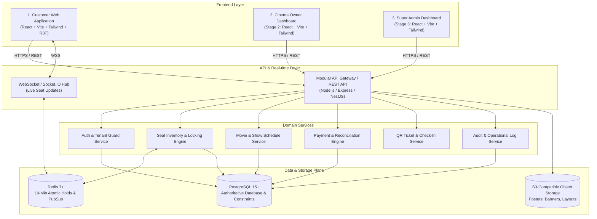
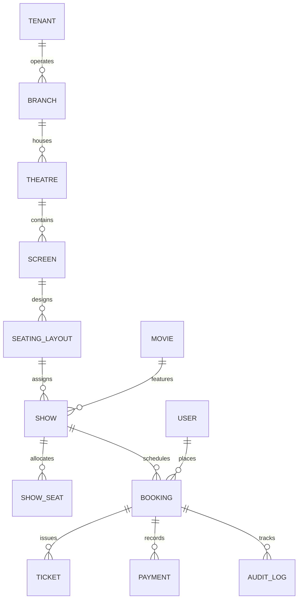

# System Architecture Specification

**Project:** Multi-Tenant Cinema Management & 3D Ticket Booking SaaS Platform  
**Document Version:** 1.0  
**Status:** Architecture Proposal for Stage 0 Sign-Off  
**Reference Document:** `docs/PHASE_0_SPECIFICATION.md`

---

## 1. High-Level System Overview

The platform is designed as an enterprise-grade, multi-tenant SaaS ecosystem serving independent cinemas and cinema chains. The system comprises three distinct user-facing applications served by a unified modular backend API and an authoritative PostgreSQL + Redis data plane:



---

## 2. Recommended Technology Stack

| Layer | Recommended Choice | Rationale & Trade-offs |
|---|---|---|
| **Frontend Framework** | **React 18 + TypeScript + Vite** | Blazing-fast HMR, lightweight bundle size, optimal ecosystem compatibility with 3D libraries (React Three Fiber). |
| **Styling** | **Tailwind CSS** | Matches Google Stitch exported tokens, responsive utilities, seamless dark/cinema theme theming. |
| **3D Rendering** | **Three.js + React Three Fiber (R3F) + Drei** | Declarative 3D scene graph in React, highly optimized WebGL rendering, mobile GPU friendly, raycasting for seat click events. |
| **2D Fallback Engine** | **HTML5 Canvas / SVG Grid** | Accessible, responsive grid fallback for low-power mobile devices and WebGL-disabled environments. |
| **Backend Runtime** | **Node.js (TypeScript) with Modular Clean Architecture** (NestJS or Modular Express) | Enterprise-grade dependency injection, clear separation of domain services, robust validation pipelines with Zod/class-validator. |
| **Database & ORM** | **PostgreSQL 15+ with Prisma ORM** | ACID transactions, strict relational foreign keys, row-level locking (`SELECT ... FOR UPDATE`), partial unique indexes for seat exclusivity. |
| **Concurrency & Fast Locks** | **Redis 7+ (via IORedis)** | 10-minute TTL atomic holds (`SET key val NX EX 600`), distributed locks (Redlock pattern where needed), and pub/sub for real-time seat status. |
| **Real-time Engine** | **Socket.IO** | Bi-directional seat status broadcasts (`seat_held`, `seat_released`, `seat_booked`) room-scoped by `showId`. |
| **Payments** | **Razorpay SDK (UPI, Netbanking, Cards)** | Native Indian payment methods (UPI Intent/QR, Google Pay, PhonePe), cryptographic webhook signature verification, refund APIs. |
| **Ticketing & QR** | **`qrcode` + HMAC-SHA256 Signed Tokens** | Generates tamper-proof QR codes containing opaque ticket references validated against backend DB records. |
| **File Storage** | **S3-compatible (AWS S3 or MinIO)** | Presigned URLs for movie posters, banners, and layout JSON snapshots. |
| **Containerization** | **Docker & Docker Compose** | Reproducible local development (PostgreSQL, Redis, MinIO) and production deployment. |

---

## 3. Multi-Tenant Architecture & Data Isolation

### 3.1 Tenant Hierarchy
```
Tenant (Cinema Company)
 └── Branches (Locations: e.g., "PVR Phoenix Marketcity", "PVR Forum Mall")
      └── Theatres / Auditoriums (Physical structures)
           └── Screens (e.g., "Screen 1 - IMAX", "Screen 2 - Dolby Atmos")
                └── Layout Versions (Seating matrix: Rows, Aisles, Tiers)
                     └── Shows (Movie + Screen + Date/Time)
                          └── Seat Inventory (Status per seat for this show)
```

### 3.2 Tenant Isolation Principles
1. **Tenant-Aware Database Columns:** Every tenant-specific table (`branches`, `theatres`, `screens`, `seating_layouts`, `shows`, `bookings`) contains an indexed `tenant_id` foreign key.
2. **Server-Side Tenant Resolution:**
   - For Cinema Owners & Staff: The user's JWT contains their verified `tenant_id` and assigned `branch_ids`.
   - APIs automatically scope queries to the authenticated user's `tenant_id`. Client-provided `tenant_id` parameters in request bodies or query params are validated against the JWT token; spoofed IDs are rejected with `403 Forbidden`.
3. **Shared Customer Account Model:** Customers possess a single global account across all cinemas. Customer records are global (`users`), while their bookings reference specific `tenant_id` and `branch_id` records.

---

## 4. Comprehensive Database Schema Model (PostgreSQL via Prisma)



### Key Relational Entities:
1. **`Tenant` (Cinema Company):** `id`, `name`, `legalName`, `gstNumber`, `status` (`PENDING_REVIEW`, `ACTIVE`, `SUSPENDED`), `cancellationPolicyJson`, `createdAt`.
2. **`Branch`:** `id`, `tenantId`, `name`, `city`, `address`, `timezone` (e.g. `Asia/Kolkata`), `operatingHoursJson`, `isActive`.
3. **`User`:** `id`, `phone`, `email`, `fullName`, `passwordHash`, `role` (`SUPER_ADMIN`, `CINEMA_OWNER`, `BRANCH_MANAGER`, `THEATRE_STAFF`, `CUSTOMER`), `tenantId` (nullable for customers/super-admins), `isActive`.
4. **`StaffAssignment`:** `id`, `userId`, `tenantId`, `branchId`, `staffType` (`TICKET_CHECKER`, `BOX_OFFICE_OPERATOR`, `MANAGER`), `permissionsJson`.
5. **`Screen`:** `id`, `branchId`, `tenantId`, `screenNumber`, `name`, `screenType` (`STANDARD_2D`, `IMAX_3D`, `DOLBY_ATMOS`), `totalCapacity`.
6. **`SeatingLayout`:** `id`, `screenId`, `version`, `name`, `dimensions` (rows, cols), `layoutJson` (grid of seats, aisles, gaps, curves, tiers), `isPublished`.
7. **`Movie`:** `id`, `title`, `description`, `posterUrl`, `bannerUrl`, `trailerUrl`, `durationMins`, `language`, `genre`, `certification` (U, UA, A), `releaseDate`, `status` (`UPCOMING`, `NOW_SHOWING`, `ARCHIVED`).
8. **`Show`:** `id`, `tenantId`, `branchId`, `screenId`, `movieId`, `layoutId`, `startTime`, `endTime`, `pricingJson` (price per category: Silver, Gold, Platinum), `bookingOpensAt`, `bookingClosesAt`, `status` (`SCHEDULED`, `CANCELLED`, `COMPLETED`).
9. **`ShowSeat` (Authoritative Inventory):**  
   `id`, `showId`, `seatCode` (e.g. "G-12"), `category` ("GOLD"), `price`, `status` (`AVAILABLE`, `HELD`, `BOOKED`, `BLOCKED`), `heldByUserId`, `holdExpiresAt`, `bookingId`, `version` (optimistic locking counter).  
   *Unique Constraint:* `@@unique([showId, seatCode])` enforces absolute prevention of double booking.
10. **`Booking`:** `id`, `bookingReference` (unique 10-char alphanumeric), `tenantId`, `branchId`, `showId`, `customerId`, `channel` (`ONLINE`, `COUNTER`), `status` (`PENDING`, `CONFIRMED`, `CANCELLED`, `EXPIRED`), `subtotal`, `taxAmount`, `convenienceFee`, `totalAmount`, `cancellationPolicyAcceptedAt`.
11. **`Payment`:** `id`, `bookingId`, `provider` ("RAZORPAY"), `gatewayOrderId`, `gatewayPaymentId`, `gatewaySignature`, `method` (`UPI`, `CARD`, `NETBANKING`, `CASH`), `amount`, `currency` ("INR"), `status` (`CREATED`, `PENDING`, `SUCCESS`, `FAILED`, `REFUNDED`), `idempotencyKey`, `rawResponseJson`.
12. **`Ticket`:** `id`, `bookingId`, `showSeatId`, `ticketNumber`, `qrPayload` (HMAC signed verification token), `status` (`ACTIVE`, `CHECKED_IN`, `CANCELLED`, `EXPIRED`), `checkedInAt`, `checkedInByStaffId`.
13. **`AuditLog`:** `id`, `tenantId`, `branchId`, `actorId`, `actorRole`, `action`, `resource`, `resourceId`, `metadataJson`, `ipAddress`, `createdAt`.

---

## 5. 3D Theatre Visualization Architecture

The 3D Theatre is the flagship customer experience. It is engineered with clear separation between the visual presentation and the authoritative booking engine:

```
                  ┌──────────────────────────────────────────────┐
                  │          Layout Configuration JSON           │
                  │   (Rows, Tiers, Aisles, Curvature, Screen)   │
                  └──────────────────────┬───────────────────────┘
                                         ▼
                  ┌──────────────────────────────────────────────┐
                  │        Procedural 3D Auditorium Builder      │
                  │             (React Three Fiber)              │
                  ├──────────────────────────────────────────────┤
                  │  • Cinema screen with glow / projection shader│
                  │  • Stepped tier risers (stadium seating)    │
                  │  • InstancedMesh for high-performance seats  │
                  │  • Raycaster for seat interaction & hover    │
                  │  • OrbitControls (constrained pitch & zoom)  │
                  │  • Camera view presets (Screen View, POV)    │
                  └──────────────────────┬───────────────────────┘
                                         ▼
                  ┌──────────────────────────────────────────────┐
                  │          Real-time State Overlay             │
                  │   (Green=Available, Blue=Selected, Gray=Held) │
                  └──────────────────────────────────────────────┘
```

### Procedural Generation Rules:
- The auditorium is **not** a static 3D model. It is procedurally generated from the screen's `layoutJson`.
- **InstancedMesh:** Renders hundreds of seats in a single WebGL draw call, guaranteeing 60 FPS on both mobile and low-power laptops.
- **Seat States:** Dynamic instance color manipulation:
  - Green / Category Color: `AVAILABLE`
  - Deep Blue / Purple: `CURRENTLY_SELECTED` by user
  - Amber: `HELD` by another customer (countdown active)
  - Dark Charcoal / Slash: `BOOKED` / `UNAVAILABLE`
  - Accessible Icon: `WHEELCHAIR_ACCESSIBLE`
- **Fallback Engine:** A crisp, responsive 2D seating matrix rendered in SVG/CSS when WebGL is unavailable or when the customer toggles "Switch to 2D View".

---

## 6. Seat Hold & Booking Engine (Zero Double-Booking Guarantee)

### 6.1 Two-Tier Concurrency Architecture
```
[Customer Selects Seats]
       │
       ▼
[Redis Atomic Hold Layer] ──> SET seat_hold:{showId}:{seatCode} {userId} NX EX 600
       │
       │ (Hold Granted: 10-Minute Expiry Countdown Starts)
       ▼
[PostgreSQL Authoritative Transaction]
  BEGIN;
  SELECT * FROM "ShowSeat" 
  WHERE "showId" = $1 AND "seatCode" IN ($2, $3) AND "status" = 'AVAILABLE'
  FOR UPDATE;
  
  -- Verify all requested seats are available
  UPDATE "ShowSeat" 
  SET "status" = 'HELD', "heldByUserId" = $userId, "holdExpiresAt" = NOW() + INTERVAL '10 minutes'
  WHERE "showId" = $1 AND "seatCode" IN ($2, $3);
  
  INSERT INTO "Booking" (status: 'PENDING', ...)
  COMMIT;
```

### 6.2 Key Operational Invariants:
1. **Atomic All-or-Nothing:** If a customer selects 3 seats and 1 is already held, the entire hold request fails cleanly. No partial holds.
2. **Authoritative 10-Minute Hold:** The 10-minute hold duration is enforced on the server. If the timer elapses before payment verification, background sweepers or real-time checks release the seats.
3. **Unified Inventory:** Counter operators and online customers execute against the exact same PostgreSQL and Redis seat locks.
4. **Idempotent Payment Webhooks:** Payment webhooks use database unique constraints on `gatewayPaymentId`. Duplicate webhooks return `200 OK` immediately without creating duplicate bookings or tickets.

---

## 7. Payment & QR Ticket Verification Architecture

1. **Order Creation:** The server calculates the exact total (Tickets + Taxes + Fees) and initiates an order with Razorpay.
2. **Client Verification:** The frontend launches the Razorpay Checkout sheet.
3. **Server-to-Server Verification:** The backend verifies the cryptographic HMAC signature (`crypto.createHmac('sha256', secret).update(order_id + '|' + payment_id)`).
4. **QR Ticket Tokenization:**
   - The QR code contains an opaque, tamper-evident token: `TKT:<tenantId>:<ticketId>:<HMAC-Signature>`.
   - Sensitive customer data or payment details are **never** encoded in the QR code.
   - When scanned by the Ticket Checker staff app, the server validates:
     1. Token cryptographic signature.
     2. Ticket status is `ACTIVE`.
     3. Showtime matches the current entry window.
     4. Atomically transitions status to `CHECKED_IN` (`UPDATE "Ticket" SET "status" = 'CHECKED_IN', "checkedInAt" = NOW() WHERE "id" = $id AND "status" = 'ACTIVE'`). Duplicate scans are flagged with exact previous check-in timestamp.

---

## 8. Role-Based Access Control (RBAC) & Security

| Role | Scope | Permitted Actions |
|---|---|---|
| **Super Admin** | Platform-Wide | Review/approve cinema applications, tenant activation/suspension, audit logs, platform metrics. |
| **Cinema Owner** | Company Tenant | Create/edit branches, assign managers, configure screens, publish layouts, view company revenue. |
| **Branch Manager** | Assigned Branches | Manage shows, view branch bookings, assign theatre staff, handle operational overrides. |
| **Theatre Staff (Checker)** | Assigned Branch / Show | Scan and validate QR entry tickets, view entry logs. |
| **Theatre Staff (Counter)** | Assigned Branch / Counter | Search shows, view real-time seat inventory, make walk-in counter bookings (Cash/UPI/Card). |
| **Customer** | Shared Identity | Browse movies/shows, view 3D auditorium, book seats, pay, view own tickets, request eligible cancellations. |

---

## 9. Infrastructure & Deployment Architecture

```
                                  [Internet]
                                      │
                                      ▼
                            [Nginx / Cloudflare]
                          SSL Termination & CDN
                                      │
              ┌───────────────────────┴───────────────────────┐
              ▼                                               ▼
    [Customer Web App]                              [Node.js API Services]
   (Vite SPA Static Assets)                           (Docker Containers)
                                                              │
                                      ┌───────────────────────┴───────────────────────┐
                                      ▼                                               ▼
                              [PostgreSQL 15]                                   [Redis 7]
                           (Authoritative Data)                            (Seat Locks & Cache)
```
- **Local Dev:** `docker-compose.yml` spins up PostgreSQL, Redis, and MinIO with healthchecks.
- **Environment Configuration:** Strongly typed configuration validated via Zod on server startup.
